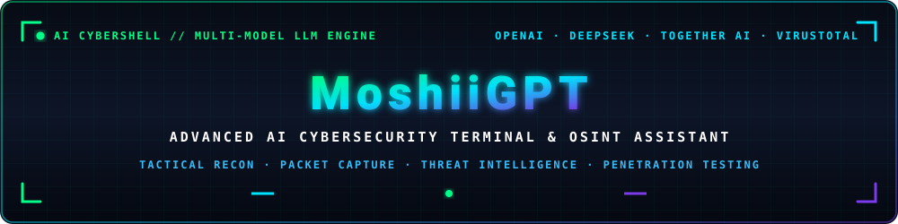

<div align="center">



<br/><br/>

# 🚀 MoshiiGPT — AI-Powered Cybersecurity Shell Assistant
### ⚡ Tactical OSINT, Network Analysis, Threat Intelligence & Automated Penetration Testing CLI

<p align="center">
  <a href="https://github.com/mohammed-moshii/moshii-GPT/stargazers"></a>
  <a href="https://github.com/mohammed-moshii/moshii-GPT/network/members"></a>
  <a href="https://github.com/mohammed-moshii/moshii-GPT/issues"></a>
  <a href="https://github.com/mohammed-moshii/moshii-GPT/blob/main/LICENSE"></a>
  <a href="https://youtu.be/uCELJLwFfhk"></a>
</p>

<p align="center">
  
  
  
  
  
  
  
</p>

<p align="center">
  <b>MoshiiGPT</b> is a next-generation AI-powered cybersecurity terminal shell assistant. Built for <b>Ethical Hackers</b>, <b>Penetration Testers</b>, <b>SOC Analysts</b>, and <b>Red Teamers</b>, it unifies leading Large Language Models (LLMs) — <code>OpenAI ChatGPT</code>, <code>DeepSeek</code>, and <code>Together AI</code> — with automated OSINT reconnaissance, packet capturing, Netcat listening, and VirusTotal threat intelligence into an interactive cyber terminal.
</p>

<p align="center">
  <a href="#-key-features"><b>Features</b></a> •
  <a href="#-video-demonstration"><b>Video Demo</b></a> •
  <a href="#-quick-installation"><b>Installation</b></a> •
  <a href="#-api-keys-setup"><b>API Keys</b></a> •
  <a href="#-command-reference"><b>Usage Guide</b></a> •
  <a href="#-faq--troubleshooting"><b>FAQ</b></a> •
  <a href="#-author--contact"><b>Author</b></a>
</p>

</div>

---

## 📺 Video Demonstration

Watch **MoshiiGPT** live in action demonstrating multi-model AI reasoning, automated subdomain harvesting, VirusTotal hash inspection, and real-time packet capturing:

<div align="center">
  <a href="https://youtu.be/uCELJLwFfhk" target="_blank">
    
  </a>
  <p><i>▶️ Click the banner above to watch the complete walkthrough on YouTube</i></p>
</div>

---

## ✨ Key Features & Capabilities

- 🤖 **Multi-Provider AI Chat Engine**: Switch on-the-fly between **OpenAI (ChatGPT)**, **DeepSeek (deepseek-chat)**, and **Together AI (Mixtral 8x7B)** for offensive security advice, exploit debugging, and payload analysis.
- 🕵️‍♂️ **Automated OSINT Reconnaissance**: One-shot WHOIS gathering, DNS record extraction, and subdomain enumeration for high-speed attack surface mapping.
- 💻 **OS & Environment Detection**: Passively or actively identify remote host operating systems via TTL and network fingerprinting.
- 🔬 **VirusTotal Threat Intelligence**: Instant verification of file hashes (MD5/SHA1/SHA256), IP addresses, domains, and URLs against 70+ antivirus engines.
- 🎧 **Targeted Packet Captures**: Background packet recording powered by `tcpdump` with protocol filtering (HTTP, DNS, TCP, ICMP) and automatic categorization in target directories.
- 👂 **Dynamic Netcat Listener**: One-command listener binding directly to specified network interfaces (e.g., `eth0`, `tun0`, `wlan0`) and designated ports.
- 📁 **Structured Telemetry & Logs**: Organized per-target logging in `/logs` for streamlined reporting and forensics.
- ⚡ **Interactive Cyber Terminal**: Custom `[moshii@GPT]$` shell with command autocompletion, persistent history (`~/.moshiigpt_history`), and rich ANSI styling.

---

## 🛠️ Comparison: Why MoshiiGPT?

| Capability | Standard Terminal | Generic ChatGPT Web | MoshiiGPT CLI |
| :--- | :---: | :---: | :---: |
| **DeepSeek Integration** | ❌ No | ❌ Separate Tab | ✅ **Native CLI (`--deepseek`)** |
| **OpenAI ChatGPT Integration** | ❌ No | ✅ Web Only | ✅ **Native CLI (`--chatgpt`)** |
| **Together AI / Open Models** | ❌ No | ❌ No | ✅ **Native CLI (`--together`)** |
| **Automated OSINT & Subdomains** | ⚠️ Manual Tools | ❌ Knowledge Only | ✅ **Integrated (`osint <target>`)** |
| **VirusTotal Hash Scanner** | ⚠️ Browser / Manual | ❌ No File Hashes | ✅ **Instant CLI (`vt <hash>`)** |
| **tcpdump Background Capture** | ⚠️ Complex Flags | ❌ No | ✅ **One-Command (`start record`)** |
| **Auto Interface IP Resolution** | ❌ No | ❌ No | ✅ **Built-in (`listen <iface>`)** |
| **Persistent History & Logging** | ⚠️ `.bash_history` | ❌ No local logs | ✅ **Per-Target Structured Logs** |

---

## ⚙️ Quick Installation

### Prerequisites
- **Operating System**: Linux (Kali Linux, Parrot Security OS, Ubuntu, Debian, or Arch Linux recommended)
- **Python**: `3.9+`
- **System Utilities**: `nmap`, `tcpdump`, `netcat`, `curl`

### 1. Clone the Repository
```bash
git clone https://github.com/mohammed-moshii/moshii-GPT.git
cd moshii-GPT
```

### 2. Automated One-Command Installer (Recommended)
Run the automated installation script with root privileges to install all dependencies, system tools, and create the global `moshiigpt` command symlink:

```bash
sudo chmod +x install.sh
sudo ./install.sh
```

### 3. Manual Installation (Alternative)
```bash
pip3 install -r requirements.txt
chmod +x moshiigpt
sudo ln -sf "$(pwd)/moshiigpt" /usr/local/bin/moshiigpt
mkdir -p logs
```

---

## 🔐 API Keys Setup

MoshiiGPT connects to external AI providers and threat intelligence feeds. Configure your keys in `apikeys.json`:

```json
{
  "chatgpt": "sk-your-openai-api-key",
  "deepseek": "sk-your-deepseek-api-key",
  "together": "your-together-ai-api-key",
  "virustotal": "your-virustotal-api-key"
}
```

> [!NOTE]
> You do not need all keys to use the tool. If you only have DeepSeek and VirusTotal, you can still use all DeepSeek and VirusTotal features seamlessly!

### Where to Obtain Your Free / Developer Keys:
- **DeepSeek API**: [platform.deepseek.com](https://platform.deepseek.com)
- **OpenAI API**: [platform.openai.com/api-keys](https://platform.openai.com/api-keys)
- **Together AI**: [together.ai](https://www.together.ai/)
- **VirusTotal API**: [virustotal.com/gui/join-us](https://www.virustotal.com/gui/join-us)

---

## 💻 Command Reference & Usage Guide

Launch the interactive shell by running:
```bash
moshiigpt
```

### 1. 🤖 AI Chat Commands
Consult specialized AI models directly from your penetration testing console:

```bash
# Query OpenAI ChatGPT
[moshii@GPT]$ chat --chatgpt "Explain bypass techniques for Cloudflare WAF SQL injection filters"

# Query DeepSeek (Excels in code analysis, deobfuscation & exploit logic)
[moshii@GPT]$ chat --deepseek "Analyze this x86 assembly snippet and identify potential buffer overflow offsets"

# Query Together AI (Open-weights Mixtral-8x7B)
[moshii@GPT]$ chat --together "Write a custom YARA rule to detect Cobalt Strike malleable C2 beacons"
```

### 2. 🕵️ OSINT & Target Reconnaissance
Map out target attack surfaces and identify subdomains, DNS records, and registrar details:

```bash
# Full OSINT scan (WHOIS, DNS records, subdomains)
[moshii@GPT]$ osint example.com

# Detect remote operating system fingerprint
[moshii@GPT]$ detect-os 192.168.1.50

# Run automated Nuclei template scans
[moshii@GPT]$ nuclei https://target.com
```

### 3. 🔬 VirusTotal Threat Intelligence
Check malicious hashes, suspicious IPs, or phishing URLs against global threat feeds:

```bash
# Scan file hash (MD5, SHA-1, SHA-256)
[moshii@GPT]$ vt 44d88612fea8a8f36de82e1278abb02f

# Scan domain or IP address
[moshii@GPT]$ vt 185.220.101.5
```

### 4. 🎧 Network Forensics & Packet Captures
Start background packet captures for specific targets and protocols without memorizing complex tcpdump syntax:

```bash
# Start background capture on specific IP and service (e.g. HTTP, DNS, ICMP)
[moshii@GPT]$ start record 192.168.1.100 http

# View active capture sessions and output paths
[moshii@GPT]$ show recordings

# Stop recording specific target
[moshii@GPT]$ stop record 192.168.1.100

# Stop all background capture processes
[moshii@GPT]$ stop all recordings
```
*Captured PCAPs are automatically saved in `/logs/<target_ip>/`.*

### 5. 👂 Tactical Netcat Listener
Bind a netcat listener to any active network interface with automatic IP resolution:

```bash
# Bind listener on interface (eth0, tun0, wlan0) and port
[moshii@GPT]$ listen eth0 4444

# Bind listener on VPN tunnel interface (HTB / TryHackMe)
[moshii@GPT]$ listen tun0 9001
```

---

## 📁 Repository Structure

```text
moshii-GPT/
├── main.py              # Main CLI entrypoint and command router
├── smart_shell.py       # Interactive terminal engine & process monitor
├── shell_core.py        # Core command execution & parsing
├── ask_ai.py            # AI provider bridges (OpenAI, DeepSeek, Together AI)
├── config.py            # Configuration loader & API key manager
├── apikeys.json         # Encrypted/local API key storage
├── install.sh           # Automated deployment & dependency installer
├── requirements.txt     # Python package requirements
├── banner.png           # YouTube walkthrough video banner
├── assets/              # High-resolution vector SVGs & UI graphics
├── osint/               # OSINT modules
│   ├── whois_lookup.py  # WHOIS registrar interrogation
│   ├── dns_lookup.py    # DNS record enumeration (A, MX, TXT, NS)
│   ├── subdomains.py    # Subdomain discovery engine
│   ├── os_detection.py  # OS fingerprinting
│   ├── virus_total.py   # VirusTotal API v3 integration
│   └── nuclei_scan.py   # Nuclei template scanner integration
└── logs/                # Organized target capture and PCAP logs
```

---

## ❓ FAQ & Troubleshooting

<details>
<summary><b>Q: Do I need paid subscriptions to use MoshiiGPT?</b></summary>
<p>No! DeepSeek provides generous free API credits upon signup, Together AI provides free trial tokens, and VirusTotal offers a completely free public API key. You only pay if you exceed commercial thresholds.</p>
</details>

<details>
<summary><b>Q: Can I run MoshiiGPT completely offline?</b></summary>
<p>Yes. All OSINT, network packet capturing (tcpdump), Netcat listening, and local terminal features work offline without an internet connection. Only the AI chat and VirusTotal queries require internet connectivity.</p>
</details>

<details>
<summary><b>Q: Is MoshiiGPT legal to use?</b></summary>
<p>MoshiiGPT is designed strictly for authorized penetration testing, bug bounty hunting, CTF competitions, security research, and educational purposes. Always ensure you have explicit written authorization before scanning or testing any target systems.</p>
</details>

<details>
<summary><b>Q: Why is DeepSeek recommended for cybersecurity tasks?</b></summary>
<p>DeepSeek's models have demonstrated extraordinary capabilities in code comprehension, reverse engineering, script generation, and exploit debugging, often outperforming generic LLMs on complex technical prompts.</p>
</details>

---

## 👨‍💻 Author & Security Research

**Mohammed Moshii** (*0xMoshii*)
- 🚀 **NASA Hall of Fame**: Honored for responsible vulnerability disclosure.
- 🎯 **TryHackMe**: Top 1% Worldwide Rank.
- 📜 **Certifications**: CEH (Certified Ethical Hacker) • CSA (Certified SOC Analyst) • PMA (Practical Malware Analysis).
- 🎓 **Academic**: Graduate Student in Computer Science at [Faculty of Graduate Studies for Statistical Research (FGSSR)](https://csds.cu.edu.eg), Cairo University.

### Connect & Transmission Channels:
- 🌐 **Portfolio Website**: [mohammed-moshii.github.io](https://mohammed-moshii.github.io)
- 💼 **LinkedIn**: [linkedin.com/in/mohammed-m0shii](https://www.linkedin.com/in/mohammed-m0shii/)
- 🎯 **TryHackMe Profile**: [tryhackme.com/p/Moshii](https://tryhackme.com/p/Moshii)
- 📺 **YouTube Channel**: [@moshii0x00](https://www.youtube.com/@moshii0x00)
- 🐙 **GitHub Profile**: [github.com/mohammed-moshii](https://github.com/mohammed-moshii)

---

## 📄 License & Disclaimer

This project is licensed under the **MIT License** — see the [LICENSE](LICENSE) file for details.

> [!WARNING]
> *Disclaimer: MoshiiGPT is provided for educational and authorized defensive/offensive security assessments only. The author is not responsible for any misuse or damage caused by this software. Always adhere to local laws and obtain proper authorization.*

<div align="center">
  <sub>⚡ Engineered with passion by Mohammed Moshii // Offense Informs Defense ⚡</sub>
</div>
